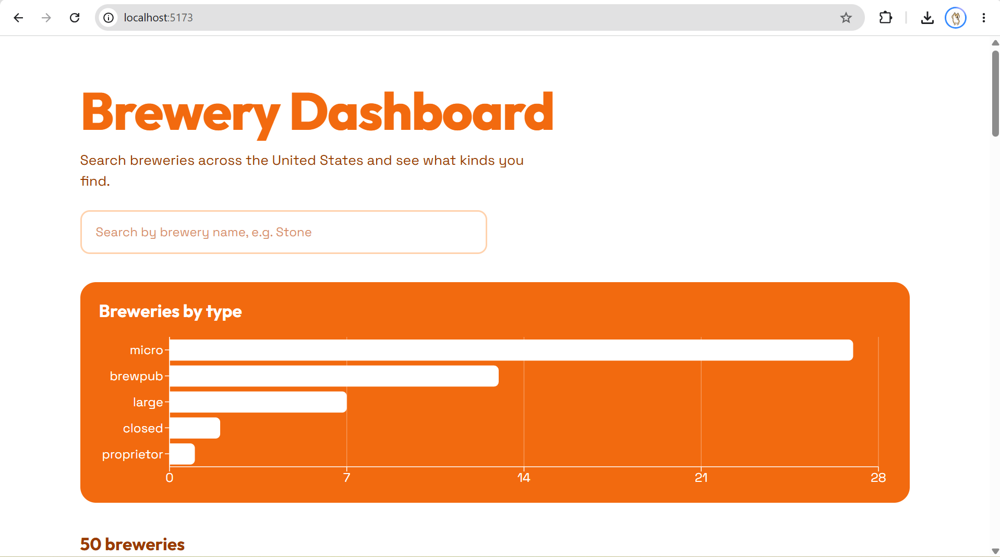
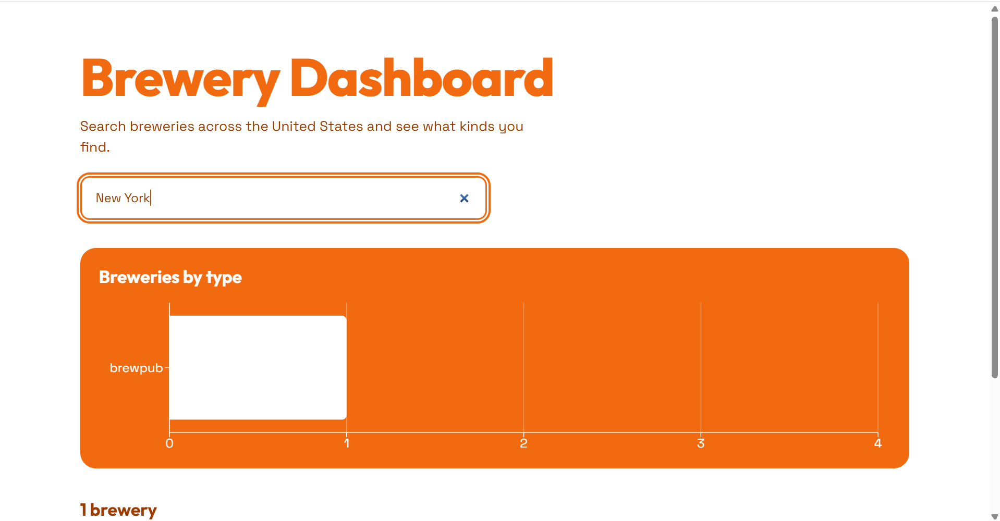
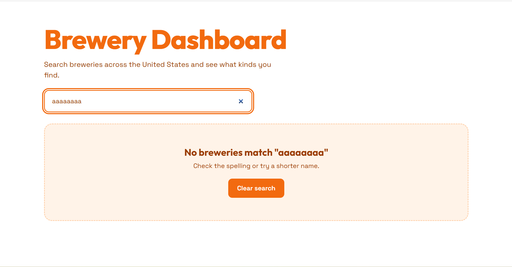
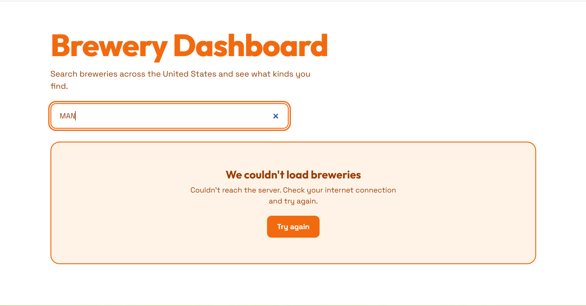

# Brewery Dashboard

**Topic 13: React Dashboard Consuming an API**

A responsive React dashboard that pulls live data from the [Open Brewery DB API](https://www.openbrewerydb.org). Users can search breweries by name, see summary stats, view a bar chart of breweries by type, filter the results by type, and browse the breweries as cards. The app has clear loading, error and empty states. It is built with React and Vite, uses Recharts for the chart, and is styled with plain CSS in a white and orange theme.

## Team Members & Roles

| Name               | Project Role                                                                                         |
| ------------------ | ---------------------------------------------------------------------------------------------------- |
| Arnav Banthia      | Lead Developer: project setup, API integration, state management, chart, cards, styling, README      |
| Dhanraj Haria      | Frontend Developer: `Footer` component                         |
| Shaurya Lalwani    | Frontend Developer: `StatsBar` component   |
| Sarthakk Mukherji  | Frontend Developer: `FilteredGrid` component                            |

Each member's work was added on their own Git branch and merged through a pull request, so every contribution is visible under their own account in the commit history and the repository's Contributors page.

## Features

- Search breweries by name (debounced, so the API isn't called on every keystroke)
- Summary stats: number of breweries, cities, countries and the most common type
- Bar chart of breweries by type, built from the fetched data
- Filter the cards by brewery type with a dropdown
- Responsive grid of cards showing name, brewery type, city and website
- Clear **loading**, **error** (with a retry button) and **empty** (no results) states

## Tech Stack

- **React** with **Vite**
- **Recharts** for the bar chart
- **Plain CSS** (white and orange palette, Google Fonts: Outfit and Space Grotesk)
- **Open Brewery DB** REST API (`https://api.openbrewerydb.org/v1/breweries`)

## Project Structure

```
brewery-dashboard/
├── index.html
├── package.json
├── README.md
├── screenshots/
└── src/
    ├── main.jsx                 entry point, mounts <App />
    ├── App.jsx                  state, API fetching, page layout
    ├── index.css                global styles and theme
    └── components/
        ├── SearchBar.jsx        controlled search input
        ├── StatsBar.jsx         summary numbers (+ StatsBar.css)
        ├── TypeChart.jsx        bar chart by brewery type
        ├── FilteredGrid.jsx     type dropdown + card grid (+ FilteredGrid.css)
        ├── BreweryCard.jsx      one brewery card
        ├── StatusMessage.jsx    loading / error / empty UI
        └── Footer.jsx           team credits (+ Footer.css)
```

## Architecture

```
+--------------------------------------------------------+
|                    React Frontend                      |
|                                                        |
|  App.jsx   state: breweries, loading, error,           |
|            searchTerm, debouncedTerm, retryCount       |
|     |                                                  |
|     |-- useEffect --> fetch() -------------------+     |
|     |                                            |     |
|     |-- props --> SearchBar                      |     |
|     |-- props --> StatsBar                       |     |
|     |-- props --> TypeChart (Recharts)           |     |
|     |-- props --> FilteredGrid                   |     |
|     |                  '-- BreweryCard (per item)|     |
|     |-- props --> StatusMessage                  |     |
|     '-- Footer                                   |     |
+--------------------------------------------------------+
                                                   |
          GET /v1/breweries?per_page=50&by_name=...
                                                   v
                       +---------------------------------+
                       |   Open Brewery DB (REST API)    |
                       +---------------------------------+
                                                   |
                          JSON array of breweries
                                                   v
             setBreweries(data) -> React re-renders the UI
```

1. The user types in the search box, which updates the `searchTerm` state.
2. After a short pause (debounce), `useEffect` sends a `fetch` request to the API.
3. The JSON response is saved with `setBreweries`, and React re-renders the stats, chart and cards.
4. If the request is slow, fails, or returns nothing, the matching loading, error or empty screen is shown instead.

## Setup Steps

You need [Node.js](https://nodejs.org) (LTS version) and [Git](https://git-scm.com) installed.

```bash
# 1. Clone the repository
git clone <repository-url>
cd brewery-dashboard

# 2. Install dependencies
npm install

# 3. Start the development server
npm run dev
```

Then open **http://localhost:5173** in your browser.

Other useful commands:

```bash
npm run build     # create a production build
npm run preview   # preview the production build locally
```

## API Usage Notes

- The Open Brewery DB API is free and public. **No API key is needed**, so there are no keys or secrets in this repository.
- To respect the API, search requests are debounced (400 ms), each request asks for at most 50 results, and an older request is cancelled when a newer one starts.

## Screenshots

**Dashboard view**



**Search results**



**Empty state (no matching breweries)**



**Error state (API unreachable)**



## Research Questions

### How do `useState` and `useEffect` work together for data fetching?

The way I think about it is that `useState` is where the data lives and `useEffect` is what goes and gets it. When the component first loads, the state is empty (an empty array for `breweries`, and `loading` set to `true`). Then `useEffect` runs after the first render, calls `fetch`, and when the response comes back I call a setter like `setBreweries(data)`. Changing state makes React re-render, so the stats, chart and cards appear with the new data.

The dependency array at the end of `useEffect` controls when it runs again. In my app it is `[debouncedTerm, retryCount]`, so a new request goes out whenever the search term settles or the user clicks "Try again". If the array were empty, the fetch would only run once when the page loads. The cleanup function (where I call `controller.abort()`) cancels the old request when a new one starts, so a slow old response can't overwrite newer results.

### Why use components and props?

Components let me break the page into small pieces that each do one job: `SearchBar`, `StatsBar`, `TypeChart`, `FilteredGrid`, `BreweryCard`, `StatusMessage` and `Footer`. That keeps `App.jsx` readable, and I can reuse a piece, like rendering `BreweryCard` once for every brewery in the array, without copying code. It also made it easy for four of us to work on different files without getting in each other's way.

Props are how those pieces get their data. `App` keeps the main state and passes down only what each child needs, for example `<StatsBar breweries={breweries} />` or `<BreweryCard brewery={brewery} />`. The child just displays what it receives, which makes it easy to understand and change. For the search box, `App` passes down `value` and `onChange`, so the state stays in one place and the child only reports what the user typed.

### How do you handle loading, errors and empty states?

I handle all three with state, and I decide what to show before rendering the actual data. I have `loading` (true while the request is running) and `error` (a message if something failed). Before every fetch I set `loading` to true and clear the error, and in a `finally` block I set `loading` to false so it always turns off whether the request worked or not.

For errors, I wrap the fetch in `try/catch`. One thing I learned is that `fetch` doesn't throw on a 404 or 500, so I check `response.ok` myself and throw an error if it is false. The error screen shows a clear message and a "Try again" button.

The empty state is different, because nothing actually went wrong: the API just returned an empty array. So after loading and error are ruled out, I check `breweries.length === 0` and show a "No breweries match" message with a button to clear the search. The order matters (loading, then error, then empty, then the real data), otherwise the user could briefly see "no results" while the data is still loading.

## Future Improvements

- Pagination or "load more" for browsing beyond the first 50 results
- Make the chart and stats follow the type filter (by moving the filter state up into `App`)
- Filter by country or state
- A favorites list saved in the browser
- Deploying the app online (Vercel or Netlify)

## Acknowledgements

Brewery data provided by the free [Open Brewery DB](https://www.openbrewerydb.org) API.
